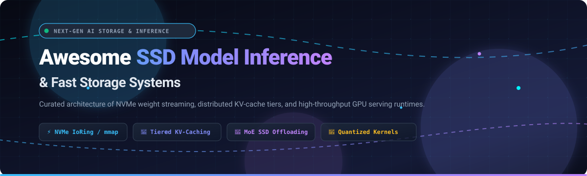

# ⚡ Awesome SSD Fast Model Inference & Storage Systems

  

  
  
  
  
  

---

## 🧭 Top SSD Fast Model Inference & Storage Systems Ecosystem

> **Curated List of SaaS/Hosted Platforms & Open-Source GitHub Projects**  
> *Focused on SSD-Offloaded LLM Inference, High-Throughput Serving Engines, Hierarchical KV-Cache Storage & Quantized Execution Kernels*  
> **Last updated: November 2026** 📅

This repository tracks notable **SaaS/hosted inference platforms** and **open-source GitHub projects** engineered for **SSD Fast Model Inference & Storage Systems**. These architectures enable developers, ML researchers, and AI engineers to run massive Mixture-of-Experts (MoE) and dense language models far larger than physical GPU VRAM or system RAM by streaming weights on-demand directly from PCIe Gen4/Gen5 NVMe SSDs, while accelerating ultra-fast GPU serving, disaggregated KV-cache tiering, and custom low-bit quantization kernels.

**Open-source emphasis**: This collection catalogs active open-source SSD-streaming runtimes, high-throughput inference engines, KV-cache storage layers, and low-bit CUDA/CPU kernels — ideal for AI infrastructure engineers and local-AI builders maximizing hardware throughput and minimizing latency without multimillion-dollar GPU clusters.

Contributions welcome! Open a PR to add or update entries. 🚀

---

## 📑 Table of Contents

- [📊 Sector Overview & Market Dynamics](#-sector-overview--market-dynamics)
- [☁️ SaaS & Hosted Inference Platforms](#️-saas--hosted-inference-platforms)
- [💻 Open-Source GitHub Projects](#-open-source-github-projects)
- [🛠️ Architectural Recommendations](#️-architectural-recommendations)
- [📈 Star History](#-star-history)
- [🤝 How to Contribute](#-how-to-contribute)
- [💖 Support](#-support)
- [⚠️ Disclaimer](#️-disclaimer)

---

## 📊 Sector Overview & Market Dynamics

The AI inference infrastructure and high-throughput model serving market is projected to expand from **$35 billion in 2024 to over $140 billion by 2030**, exhibiting a compound annual growth rate (CAGR) exceeding 26% as production enterprise workloads shift heavily from training to continuous inference.

The sector demonstrates a **moderately fragmented yet tiered competitive structure**: hyperscalers and semiconductor titans (NVIDIA NIM, Microsoft, Amazon AWS) dominate enterprise hardware-software co-design, while an agile cohort of specialized serverless and inference-cloud providers (Fireworks AI, Together AI, Modal, Baseten) fiercely compete on price-per-token, latency to first token (TTFT), and custom kernel optimization. Simultaneously, open-source innovations (vLLM, llama.cpp, SGLang, InferSSD, Mooncake) operate as foundational standards driving rapid community commoditization across storage-offloaded inference runtimes.

---

## ☁️ SaaS & Hosted Inference Platforms

The following hosted inference and serverless GPU platforms deliver managed production deployment, tiered NVMe weight/KV caching, speculative decoding, and low-latency API serving. Ranked descending by company scale (valuation / enterprise revenue):

| Platform | Company Valuation / Revenue | Starting Pricing Tier | Free Tier & Trial Limits | Key Capabilities & Highlights |
| :--- | :--- | :--- | :--- | :--- |
| **[NVIDIA NIM](https://www.nvidia.com/en-us/ai/)** | **~$3.5 Trillion** (Market Cap) | **$1.00 / GPU-hour** via NVIDIA Cloud Functions (or $4,500 / GPU / year enterprise license) | **90-Day Free Evaluation** with 1,000 API credits on NVIDIA AI Foundation | Production-ready microservices leveraging TensorRT-LLM and optimized GPU storage pipelines for low-latency enterprise models. |
| **[Together AI](https://together.ai)** | **~$3.3 Billion** (Valuation) | **$0.18 / 1M tokens** (Llama 3.1 8B) & dedicated GPU clusters from **$1.50 / GPU-hr** | **$5.00 Free Usage Credit** upon sign-up (valid for 90 days across API endpoints) | Cloud inference and fine-tuning platform built on FlashAttention with distributed MoE execution and persistent weights cache. |
| **[Hugging Face Inference Endpoints](https://huggingface.co)** | **~$4.5 Billion** (Valuation) | **$0.06 / hour** (CPU instance) & **$0.60 / hour** (Dedicated Nvidia T4 GPU) | **Free Forever** public Hub serverless inference API (rate limited to ~30k tokens/mo) | Dedicated, autoscaling cloud deployment service powered by Text Generation Inference (TGI) and safetensors instant cold starts. |
| **[Anyscale Endpoints](https://anyscale.com)** | **~$1.0 Billion** (Valuation) | **$0.15 / 1M tokens** (Llama-3 8B) & Ray managed clusters from **$0.70 / worker-hr** | **$10.00 Free Trial Credit** granted on account creation (valid across all serverless models) | Managed LLM serving platform built on Ray and vLLM offering autoscaling, continuous batching, and high-throughput enterprise APIs. |
| **[Fireworks AI](https://fireworks.ai)** | **~$552 Million** (Valuation) | **$0.20 / 1M tokens** (Serverless 8B models) & on-demand deployments from **$1.90 / hr** | **$1.00 Free Credit** upon account setup (permanent access, no credit card required upfront) | Ultra-fast generative AI inference cloud powered by FireAttention kernels, speculative decoding, and multi-tier KV caching. |
| **[Modal](https://modal.com)** | **~$250 Million** (Valuation) | **$0.000053 / core-sec** (CPU) & **$0.000164 / sec** (~$0.59 / hr for Nvidia T4 GPU) | **$30.00 Free Credits Every Month** (Free forever tier renewing each monthly cycle) | Serverless cloud compute platform optimized for AI with rapid container snapshot loading and distributed NVMe model caching. |
| **[Baseten](https://baseten.co)** | **~$250 Million** (Valuation) | **$0.40 / GPU-hr** (Nvidia T4) & **$1.75 / GPU-hr** (Nvidia A10G) dedicated instances | **$30.00 Free Platform Credits** granted for model testing on sign-up | Managed ML deployment infrastructure integrating TensorRT-LLM, vLLM, and sub-second cold-start model storage streaming. |

---

## 💻 Open-Source GitHub Projects

Curated open-source runtimes, SSD-offloading engines, KV-cache storage layers, and matrix multiplication kernels. Ranked descending by GitHub stargazers count:

| Repository | GitHub Stars | Description & Offloading Features |
| :--- | :---: | :--- |
| **[ollama/ollama](https://github.com/ollama/ollama)** |  | Get up and running with Llama, Mistral, Gemma, and MoE models locally; auto-manages CPU/GPU memory layers and SSD model caching. |
| **[ggml-org/llama.cpp](https://github.com/ggml-org/llama.cpp)** |  | Foundational C/C++ LLM inference engine supporting direct memory-mapped (`mmap`) GGUF model execution straight from NVMe SSDs. |
| **[vllm-project/vllm](https://github.com/vllm-project/vllm)** |  | High-throughput, memory-efficient LLM serving engine featuring PagedAttention, continuous batching, and hierarchical CPU/disk KV-cache offloading. |
| **[mudler/LocalAI](https://github.com/mudler/LocalAI)** |  | Open-source OpenAI alternative to run LLMs, vision, and audio models locally without GPU requirements, leveraging fast disk caches. |
| **[deepspeedai/DeepSpeed](https://github.com/deepspeedai/DeepSpeed)** |  | Microsoft deep learning optimization library featuring ZeRO-Inference for streaming massive model weights directly from NVMe SSDs to GPUs. |
| **[lyogavin/airllm](https://github.com/lyogavin/airllm)** |  | Executes massive 70B–405B models on single 4GB/8GB consumer GPUs by streaming model layers on-the-fly sequentially from SSD. |
| **[sgl-project/sglang](https://github.com/sgl-project/sglang)** |  | High-performance serving framework utilizing RadixAttention for automatic KV-cache reuse and tiered CPU/SSD multi-level memory caching. |
| **[ml-explore/mlx](https://github.com/ml-explore/mlx)** |  | Apple Silicon machine learning framework exploiting unified memory architectures and high-bandwidth APFS SSD streaming. |
| **[Dao-AILab/flash-attention](https://github.com/Dao-AILab/flash-attention)** |  | Fast and memory-efficient exact attention algorithms that eliminate memory-bandwidth bottlenecks during training and inference. |
| **[kvcache-ai/ktransformers](https://github.com/kvcache-ai/ktransformers)** |  | Heterogeneous CPU/GPU kernel-injection framework keeping cold MoE experts in system RAM/storage while running hot computation on GPU. |
| **[NVIDIA/TensorRT-LLM](https://github.com/NVIDIA/TensorRT-LLM)** |  | NVIDIA production inference runtime featuring custom FlashAttention kernels, in-flight batching, and host/NVMe KV-cache offloading. |
| **[LMCache/LMCache](https://github.com/LMCache/LMCache)** |  | High-speed KV-cache storage and sharing layer for vLLM/SGLang that saves and reuses KV caches across GPU, CPU, and local NVMe SSDs. |
| **[huggingface/text-generation-inference](https://github.com/huggingface/text-generation-inference)** |  | Production-grade LLM serving toolkit with safetensors zero-copy weight loading, FlashAttention, and optimized token streaming. |
| **[Tiiny-AI/PowerInfer](https://github.com/Tiiny-AI/PowerInfer)** |  | Fast local inference engine exploiting neuron activation locality to split hot/cold weights dynamically across GPU and CPU/SSD storage. |
| **[FMInference/FlexLLMGen](https://github.com/FMInference/FlexLLMGen)** |  | High-throughput inference engine optimizing compute and memory offloading across GPU memory, CPU DRAM, and NVMe SSD tiers. |
| **[InternLM/lmdeploy](https://github.com/InternLM/lmdeploy)** |  | High-performance toolkit for LLM compression and serving featuring TurboMind runtime, 4-bit quantization, and blocked KV caching. |
| **[ml-explore/mlx-lm](https://github.com/ml-explore/mlx-lm)** |  | Python utility package to run, fine-tune, and quantize Hugging Face LLMs natively with Apple MLX on macOS with fast disk offloading. |
| **[kvcache-ai/Mooncake](https://github.com/kvcache-ai/Mooncake)** |  | Kimi's open-source KVCache-centric disaggregated architecture pooling DRAM, SSD, and RDMA resources across clusters for massive contexts. |
| **[flashinfer-ai/flashinfer](https://github.com/flashinfer-ai/flashinfer)** |  | High-performance GPU kernel library for LLM serving with state-of-the-art paged attention and fused rotary positional embeddings. |
| **[AutoGPTQ/AutoGPTQ](https://github.com/AutoGPTQ/AutoGPTQ)** |  | User-friendly 2, 3, 4, and 8-bit quantization package based on the GPTQ algorithm to shrink model footprints for fast disk-to-VRAM transfers. |
| **[turboderp-org/exllamav2](https://github.com/turboderp-org/exllamav2)** |  | Ultra-fast inference library optimized for quantized EXL2 weights on consumer GPUs with dynamic memory paging and minimal overhead. |
| **[safetensors/safetensors](https://github.com/safetensors/safetensors)** |  | Zero-copy, memory-mappable tensor format designed for instantaneous, secure weight streaming directly from NVMe SSD storage. |
| **[mit-han-lab/llm-awq](https://github.com/mit-han-lab/llm-awq)** |  | Activation-aware Weight Quantization (AWQ) for low-bit model compression and acceleration without hardware perplexity degradation. |
| **[dphnAI/sonar](https://github.com/dphnAI/sonar)** |  | Scalable LLM inference engine supporting flexible multi-quantization runtimes and OpenAI-compatible API microservices. |
| **[NVIDIA/gdrcopy](https://github.com/NVIDIA/gdrcopy)** |  | Fast GPU memory copy library based on NVIDIA GPUDirect RDMA technology, bypassing CPU bounce buffers for fast device streaming. |
| **[wici-ai/inferssd](https://github.com/wici-ai/inferssd)** |  | Streams Mixture-of-Experts (MoE) weights directly from NVMe SSDs via OS read rings (`io_uring`, `IoRing`, `F_NOCACHE`) for 700B+ models. |
| **[IST-DASLab/marlin](https://github.com/IST-DASLab/marlin)** |  | FP16xINT4 CUDA matrix multiplication kernel achieving near-ideal ~4x speedups for quantized LLM inference on modern GPUs. |

---

## 🛠️ Architectural Recommendations

- **Single-GPU / Consumer Desktop Local MoE**: Pair **InferSSD** or **llama.cpp** (`mmap`) with fast PCIe Gen4/Gen5 NVMe SSDs to run 70B–800B+ MoE models without requiring hundreds of gigabytes of VRAM.
- **High-Throughput Production Serving**: Deploy **vLLM** or **SGLang** alongside **LMCache** and **FlashInfer** to persist KV caches across NVMe storage, slashing time-to-first-token (TTFT) by up to 10x for long prompts.
- **Disaggregated Cluster Infrastructures**: Integrate **Mooncake** for disaggregated prefill/decode architectures that pool distributed DRAM, SSD, and RDMA storage across massive clusters.

---

## 📈 Star History

---

## 🤝 How to Contribute

Contributions are warmly welcomed! Help keep this ecosystem comprehensive, current, and accurate:

1. 🍴 **Fork** this repository.
2. 🌿 Create a feature branch: `git checkout -b feature/new-storage-engine`.
3. 📝 Add or update entries in `README.md` following the existing tabular and badge formats.
4. 💡 Ensure factual descriptions, official documentation URLs, and GitHub links.
5. 🚀 Submit a **Pull Request** with a clear explanation of the additions.

---

## 💖 Support

Thank you for exploring and supporting **Awesome SSD Fast Model Inference & Storage Systems**!

If this project helps accelerate your research, infrastructure deployments, or local AI setups:
- ⭐ **Star** this repository on GitHub
- 🍴 **Fork** and share it with fellow AI engineers and researchers
- ☕ Consider buying a coffee or becoming a sponsor:  
  👉 **[Sponsor Dashboard on GitHub](https://github.com/sponsors/ishandutta2007)**

Your sponsorship and contributions keep this directory updated and thriving!

---

## ⚠️ Disclaimer

- This is an open **community-curated** directory — not an endorsement of any vendor or tool.
- SSD-streamed inference runtimes perform sustained high-throughput NVMe read operations. Ensure adequate thermal cooling, verify PCIe bus health, and monitor drive SMART metrics regularly.
- Default local inference endpoints may expose unauthenticated REST APIs; ensure local binding to `127.0.0.1` or place services behind an authenticated gateway on shared environments.

---

  <b>Built with ❤️ for AI infrastructure engineers, ML researchers, and local-LLM enthusiasts.</b> 
  Accelerating model inference and NVMe storage offloading for everyone.

